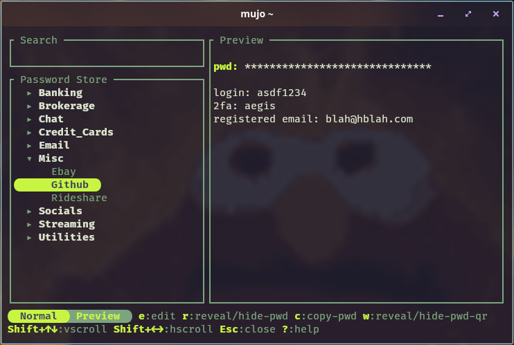

# mujo

A terminal UI for `pass` and GPG. Tree navigation, entry preview, decrypted
editing, QR codes for passwords, and git status/push/pull.

## Quick start

mujo is a front end for `pass`, so it needs `pass`, GPG and a store to work with.

**1. Prerequisites**

    # Debian / Ubuntu
    sudo apt install pass gnupg

    # macOS
    brew install pass gnupg pinentry

Other distributions: see [Requirements](#requirements).

**2. A GPG key**

    gpg --full-generate-key                       # skip if you already have one
    gpg --list-secret-keys --keyid-format long    # note the key id

**3. mujo itself** — download the release binary for your platform:

    # Linux (x86_64)
    curl -L -o mujo \
      https://github.com/AnyookDev/mujo/releases/latest/download/mujo-v0.1.0-linux-x86_64
    install -m755 mujo ~/.local/bin/

    # macOS (universal: Intel + Apple silicon)
    curl -L -o mujo \
      https://github.com/AnyookDev/mujo/releases/latest/download/mujo-v0.1.0-macos-universal
    install -m755 mujo /usr/local/bin/
    xattr -d com.apple.quarantine /usr/local/bin/mujo 2>/dev/null || true

Check the asset name against the [latest release](https://github.com/AnyookDev/mujo/releases/latest)
— it carries the version number. To build from source instead, see [Build](#build).

**4. Run it**

    mujo

The store is the one `pass` uses: `$PASSWORD_STORE_DIR` if your shell sets it,
otherwise `~/.password-store`. If there is no store there yet, mujo offers to
create one on first run — press `y`, type the key id from step 2 and press
Enter. It checks the key exists first, so a typo is correctable in place, then
runs `pass init` and initialises the git repo for you.

If you already have a store there, mujo just opens it.

`$PASSWORD_STORE_DIR` is pass's own variable, for when your store lives
somewhere non-standard; mujo only reads it.

## Requirements

`pass` and `gpg`, plus a **pinentry** so gpg can prompt for your passphrase. You
also need a GPG key and an initialised store (`pass init <key-id>`), and `git` if
you want the git features.

| Platform | Install |
| --- | --- |
| Debian / Ubuntu | `sudo apt install pass gnupg` |
| Fedora / RHEL | `sudo dnf install pass gnupg2` |
| Arch | `sudo pacman -S pass gnupg` |
| macOS | `brew install pass gnupg pinentry` |

`mujo --diagnose` prints what it can see about all of the above.

**On a desktop** this is all you need. The pinentry your distribution installs
is fine — a graphical one opens a window for your passphrase.

**Over SSH, or on any headless machine**, you need a terminal-based pinentry.
A graphical one opens its window on the remote machine's own screen, where you
can't see it, and on Debian/Ubuntu the `pinentry` default is exactly that.

    sudo apt install pinentry-curses
    printf 'pinentry-program /usr/bin/pinentry-curses\n' >> ~/.gnupg/gpg-agent.conf
    gpgconf --kill gpg-agent

It draws its own box on the terminal, so you will see the interface replaced
while it prompts, and a brief flash of your shell as it exits.

If no pinentry is configured at all, gpg hangs with no prompt anywhere.

mujo uses whatever pinentry gpg-agent is configured with. A terminal one
(curses/tty) draws inside the terminal — mujo sets `GPG_TTY` for gpg-invoking
children when the environment has none, so it works even without `GPG_TTY`
exported in the shell. A graphical one opens a window; on macOS `pinentry-mac`
needs a GUI session, so over ssh the window appears on the remote desktop.
`mujo --diagnose` reports which pinentry is effective.

Also export a tty for gpg. mujo does this for its own children, so mujo works
without it — it matters for `pass` and `gpg` run straight from the shell, where
stdin is often a pipe and a terminal pinentry then has no tty to draw on.

    # ~/.config/fish/config.fish
    set -x GPG_TTY (tty)

    # ~/.bashrc or ~/.zshrc
    export GPG_TTY=$(tty)

### Fonts

mujo's markers are plain Unicode by default — half blocks and box drawing —
which every terminal renders with no setup. If you would rather have rounded
icons for folders, mode indicators, and the selector field, install a Nerd Font
and select it in your terminal's own settings:

    # macOS
    brew install --cask font-jetbrains-mono-nerd-font

    # Arch
    sudo pacman -S ttf-jetbrains-mono-nerd

    # Debian / Ubuntu / Fedora — download from https://www.nerdfonts.com,
    # unpack into ~/.local/share/fonts, then
    fc-cache -f

That is usually all of it. The default `glyphs = "auto"` scans the installed
fonts and switches to the icon set when it finds one — `mujo --diagnose` prints
that scan as `nerd fonts`, so you can see what it saw. To pin the choice instead,
uncomment the `glyphs` line in `config.toml` and set it to `nerd`:

    glyphs = "nerd"

The tiers are `nerd` (icons), `bmp` (half blocks, the fallback) and `ascii`
(literal `[`/`]`, for CJK locales). `auto` resolves to `ascii` on a CJK locale
and to `bmp` over SSH — where the font scan looks at the remote machine's fonts,
not your laptop's. If your local terminal is the one with the font, set
`glyphs = "nerd"` on the remote.

Installing the font without selecting it in the terminal gives you tofu boxes
where the icons should be.

**With a smartcard or YubiKey**, nothing extra is needed on the machine holding
the card. If you work over SSH from elsewhere, forward the agent's extra socket
and the remote needs no pinentry and no `scdaemon`:

    # ~/.ssh/config
    Host remotebox
      RemoteForward /run/user/1000/gnupg/S.gpg-agent /run/user/1000/gnupg/S.gpg-agent.extra
      StreamLocalBindUnlink yes

Match the uid in both paths, and keep `StreamLocalBindUnlink yes` — without it
sshd will not bind over the remote's own agent socket.

## Install

### Release binaries

A universal macOS binary and a Linux x86_64 binary are attached to each
[release](https://github.com/AnyookDev/mujo/releases). Both are static with
respect to Rust, so they need nothing beyond the runtime requirements above.

    # Linux
    install -m755 mujo-v0.1.0-linux-x86_64 ~/.local/bin/mujo

    # macOS
    install -m755 mujo-v0.1.0-macos-universal /usr/local/bin/mujo

`~/.local/bin` is on `PATH` by default on most Linux distributions; if it isn't,
add it. On macOS, `/usr/local/bin` is on `PATH` for both bash and zsh.

Verify before installing — the `.sha256` files are published alongside:

    sha256sum -c mujo-v0.1.0-linux-x86_64.sha256        # Linux
    shasum -a 256 -c mujo-v0.1.0-macos-universal.sha256 # macOS

These are checksums, not signatures — they catch a truncated download, not a
tampered release.

### From source

    git clone https://github.com/AnyookDev/mujo.git
    cd mujo
    cargo build --release --locked
    install -m755 target/release/mujo ~/.local/bin/

See [Build](#build) for toolchain prerequisites.

## Build

Requires a Rust toolchain (`rustup` is the easy route) plus:

| Platform | Extra |
| --- | --- |
| Debian / Ubuntu | `sudo apt install build-essential pkg-config` |
| Fedora / RHEL | `sudo dnf install gcc make` |
| Arch | `sudo pacman -S base-devel` |
| macOS | `xcode-select --install` (linker and SDK) |

Then:

    cargo build --release --locked
    ./target/release/mujo

The binary is `target/release/mujo`. `--locked` uses the committed `Cargo.lock`.

**macOS universal binary** (Intel + Apple silicon) — needs both targets, which
`rustup` can add:

    rustup target add x86_64-apple-darwin aarch64-apple-darwin
    sh scripts/build-macos-universal.sh

It writes `dist/mujo-v<version>-macos-universal` plus a `.sha256`, runs
`lipo -info` and `--version` as smoke tests, and ad-hoc signs the result, which
arm64 requires.

## Configuration

`~/.config/mujo/config.toml` is written on first run with every option already
present but commented out — theme colours, glyphs, truecolor, keyboard layout.
Uncomment the lines you want and edit them in place.

Press `r` in mujo to reload. Changes take effect immediately, which is the easy
way to tune colours — you can watch them land without restarting.

`git.remote_url` is authoritative over the store's git remote URL: mujo rewrites
the git remote from config on refresh, so an external `git remote set-url` is
reverted on the next refresh. To change the push target, edit config.toml or use
the git pane's setup.

## macOS notes

**Terminal.app** binds ⇧↑/⇧↓ to view scrolling and sends no escape sequence for
them, so line selection in the editor and scrolling in the preview don't
respond. Add these two rows in *Settings → Profiles → [profile] → Keyboard*
(Key = the arrow with Shift, Action = `Send Text`):

| Key | Send Text |
| --- | --- |
| ⇧↑ | `\033[1;2A` |
| ⇧↓ | `\033[1;2B` |

The final byte must be uppercase — `\033[1;2a` is a different sequence that
isn't parsed. Terminal.app already ships correct mappings for ⇧←/⇧→; use those
as the template.

Terminal.app also synthesises bold for block glyphs, so any half block drawn in
bold smears vertically. Not an issue in iTerm2, kitty or cosmic-terminal.

**QR codes** need roughly one terminal row per module. A long password or a
short window uses a denser render that still scans but looks coarser —
noticeably speckled on Terminal.app.

**Keyboard layout.** A Mac keyboard advertises `Ctrl+U/D` where a PC keyboard
advertises `Ctrl+↑/↓`, because macOS captures Ctrl+arrows. The layout is
detected from the target, but over SSH the detection sees the remote, so
uncomment the `keyboard` line in `config.toml` and set it to `mac` if you are
connecting from a Mac:

    keyboard = "mac"

## Keys

Press `?` or `Ctrl+/` in the app for the full list, grouped by mode.

## Troubleshooting

| Symptom | Cause | Fix |
| --- | --- | --- |
| `e` hangs over SSH, no prompt anywhere | agent has no `DISPLAY` and the pinentry is graphical, with no fallback | run `mujo --diagnose`, set `pinentry-program` to `pinentry-curses`, then `gpgconf --kill gpg-agent` |
| prompt appears on the remote machine's screen | agent has a display, so the graphical pinentry draws there | same |
| `gpg: Inappropriate ioctl for device` | `GPG_TTY` unset or not exported | add it to your shell rc |
| `gpg: error getting version from 'scdaemon'` | `scdaemon` not installed; only matters with a card | `apt install scdaemon` |
| `pass` prompts but mujo doesn't | different terminal | run mujo in the terminal you tested `pass` in |
| folders are missing after cloning the store | git does not track empty directories; mujo writes a `.gitkeep` when it creates a folder (and during `pass git init`) so folders survive a clone | the source store predates that — commit `.gitkeep` files there, push, and re-clone |
| `mujo` not found after `install` | `~/.local/bin` not on `PATH` | add it to your shell rc |
| icons show as empty boxes | `glyphs` is set to `nerd` but the terminal isn't using a Nerd Font — or you are over SSH and the remote has none | see [Fonts](#fonts); check `mujo --diagnose` |

## Licence

MIT
